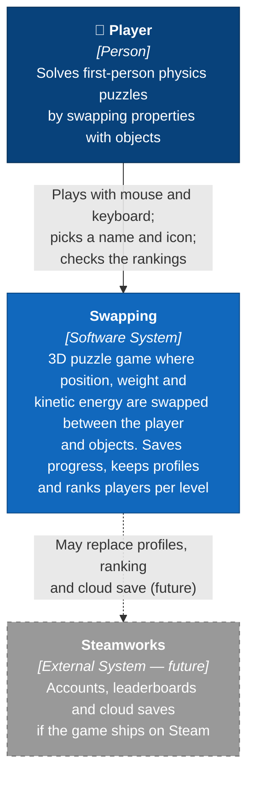
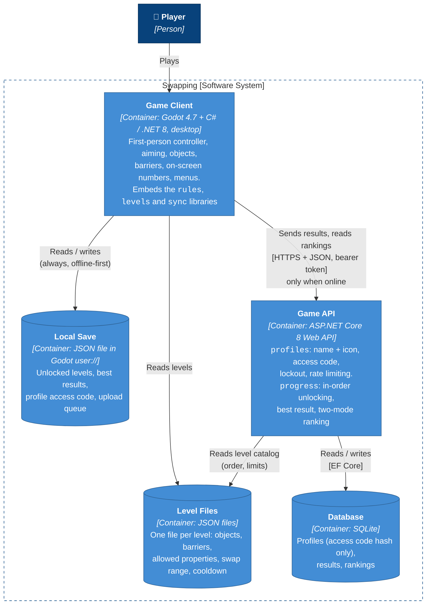

# C4 Model — Swapping

Written **before any code**, as the assignment requires (levels 1 and 2 of the
[C4 model](https://c4model.com/)). Levels 3 (Components) and 4 (Code) will be added at the end of
construction, from the real code.

Sources: [`CAPABILITY-MAP.md`](../../CAPABILITY-MAP.md),
[one-pager](../ideas/troca-de-propriedades.md), [ideas bank](../ideas/BANCO-DE-IDEIAS.md).

---

## Level 1 — System Context

Who uses the system and what it talks to.

**Notes**
- There is a single kind of user: the player. Profiles have no password or e-mail, so no personal
  data enters the system.
- Steamworks is drawn dashed: it is not part of this version. The architecture keeps profiles and
  ranking behind the API so they can be swapped for Steam later.

---

## Level 2 — Containers

The separately runnable or deployable pieces inside Swapping, and how they talk.

### Containers

| Container | Technology | Responsibility | Modules inside |
|---|---|---|---|
| Game Client | Godot 4.7, C#, .NET 8 | Everything the player sees and touches; applies the swap rules to Godot physics bodies | `game`, plus the libraries `rules`, `levels`, `sync` |
| Level Files | JSON | Describe each level; the same files are read by the game and the API | data for `levels` |
| Local Save | JSON in `user://` | Lets the game run fully offline; holds the upload queue | data for `sync` |
| Game API | ASP.NET Core 8 | Profiles, access codes, results and rankings | `profiles`, `progress` |
| Database | SQLite | Persists profiles and results | data for `profiles`, `progress` |

### Key decisions shown here
1. **Offline-first.** The game never needs the API to be played. Results go to the local save first
   and are uploaded from a queue when the API is reachable. The API keeps the *best* result, so
   re-sending is harmless.
2. **The rules live in the client.** The swap rules run inside the game, not on the server: it is a
   single-player game, and Godot physics is not deterministic, so the server could not replay a run
   anyway. The API only checks that results are plausible (level exists, unlocked in order, values in
   range).
3. **Shared level files.** Game and API read the same JSON, so the level order and limits never
   drift apart.
4. **Security without passwords.** The server generates an access code, stores only its hash, locks
   out repeated failures and rate-limits uploads. A profile can only change its own results.
5. **Libraries are not containers.** `rules`, `levels` and `sync` are plain C# libraries compiled
   into the Game Client (and `levels` into the API too). They will appear at level 3 (Components),
   where most of the automated tests live.

### Future containers (not built now)
- **Ghost storage** (P2): ghost runs of top players, attached to results in the API.
- **Steamworks** (P3): may replace the Game API's profiles and ranking.
